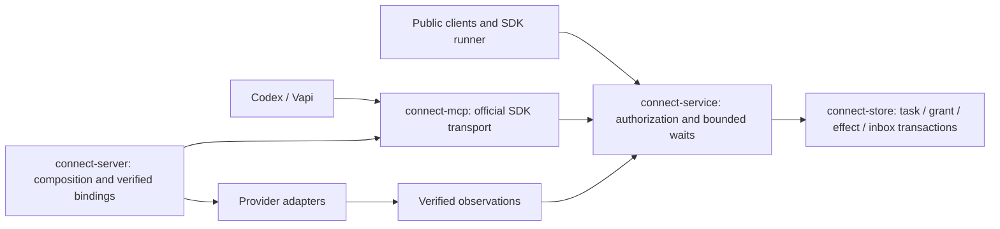

# Connect architecture

Connect is a local communications server with a durable application model over
UCTP/QUIC. The same typed application operations are available through the Rust client,
Python/TypeScript native-helper SDKs, and an explicit loopback HTTP/JSON facade.
A loopback WebSocket parity listener exercises the same control profile; it is
not a native QUIC SDK or telephone media endpoint.

## Ownership

| Layer | Responsibility |
|---|---|
| connect-protocol | Profile, operations, outcomes, errors and limits; no transport/storage |
| connect-store | SQLite transactions, identity/credentials, immutable receipts, journal, sessions, context, availability, artifacts, provider jobs and recovery |
| connect-service | Authenticated operation dispatch and application authorization |
| connect-connector-api | Storage-independent message/voice requests and provider observations |
| connect-connectors | Telnyx/Vapi provider adapters and callback validation |
| connect-client | Rust native UCTP/QUIC authentication and request exchange |
| connect-mcp | Official MCP SDK transport, current-grant tool projection and service-only task dispatch |
| connect-server | Listeners, CLI lifecycle, explicit durable-job→adapter mapping and bounded workers |
| sdk/python, sdk/typescript | Public operations, validated types/results, helper/HTTP transports and stable errors |

The adapters do not import the store. They attempt provider actions and classify
rejection versus uncertainty; the server owns durable intent, retry decisions,
correlation and journal publication. Third-party adapters currently register in
server composition at build time; a dynamic plugin loader is not implemented.

## One operation

The transport authenticates a credential and hands a request to the service.
The store checks current authority and either commits effect+receipt+journal
atomically or rejects without acceptance. Replays use the actor's logical request
ID and return the original result only under current authority. Inbox notification
is a wake hint; SQLite is authoritative. Provider workers consume durable intents
and store observations. Unknown creation outcomes are not automatically repeated.

Worker shutdown cancels intake, drains every owned worker under a shared deadline,
reports returned errors/panics, and aborts stalled tasks. Cancelling the drain also
aborts its tasks. This is not a claim of automatic worker supervision/restart.

## Voice boundary

The Gate 2 verified route is handset ↔ Telnyx ↔ Vapi. Connect provisions, initiates,
observes, correlates and terminates those provider calls; it does not carry their audio.
The assistant can answer while Connect is offline, and inbound discovery catches
up later. The Gate 3 native QUIC→Connect→Vapi WebSocket bridge is implemented
and proven against a loopback duplex provider. A separate rvoip SIP path admits
configured inbound calls and originates SDK-requested calls inside a durable
Session. The recorded Telnyx telephone topology is live-qualified; general carrier/NAT reachability is not inferred.

## Gate 3 session and native media boundary

Connect remains authoritative for persistent Conversations and durable Session
intent. An authenticated UCTP resolver rechecks current credential authority and
projects exact installation-namespaced conversation/session IDs into rvoip.
rvoip owns live Connections, Streams, subscription routing and media pumps. The
projection is disposable; restart records interruption and never pretends to
restore a socket.

The Rust SDK separates correlated replies from unsolicited UCTP events and
maintains one peer-global media router. Two independent clients can publish and
subscribe to PCMU/8 kHz streams through the local server. HTTP and native control
share the same durable session, context, availability and artifact state.

Vapi duplex attachment, bounded context delivery, transcript/outcome import and
restart continuity pass account-free integration tests. Local SIP and WebRTC
adapters exchange duplex media with Vapi; WebRTC also exchanges duplex media
with native QUIC and SIP connections in the same Session. Managed external blobs
are integrity checked and included in consistent backup/restore. Native Vapi, Telnyx telephone, Chrome WebRTC and installed-candidate
qualification pass in the recorded local scope. Read the [qualification report](evidence/gate-3/acceptance.html) for source provenance, failures and limits. See
[decision 006](decisions/006-gate-3-contracts.html) and
[decision 007](decisions/007-gate-3-media-profile.html).

Schema 11 adds Gate 4 task tables; schema 12 adds protected effect authority and
provider-resource correlation without rebuilding earlier tables. These extend
the Gate 3 durable model, SIP-leg intent and SMS eligibility. Existing installations, backups,
provider credentials and remote resources are not modified by source checks.
Presence/contact preferences remain backlog decision B-001. Recorded live SMS
qualification is separate from offline source checks. [Wire contract](../contracts/connect-control-v1.md) ·
[Contributor workflow](../CONTRIBUTING.md) · [Connector guide](CONNECTORS.md).

## Gate 4 task boundary

The approved [task runtime decision](decisions/009-task-runtime.md) extends the
application contract with `connect-task/1`. A task belongs to one durable
conversation; ending voice or a model turn never closes that conversation.
Current authority is checked before effects and receipt replay. A durable effect
identity survives uncertainty; an expired worker lease cannot justify a resend.

These are implementation boundaries. The numbered plan records which components
are actually delivered; research and typed fixtures are not runtime qualification.

The MCP adapter imports protocol/service interfaces, never SQLite. The host
adapter owns exact task-to-session mapping and protected grant refresh; examples
use public clients. No full Thelve registry or connector framework replacement
is required. [Reuse provenance and owner authorization](evidence/gate-4/reuse-map.json)
and [host selection](evidence/gate-4/host-selection.json) distinguish selected
interfaces from future qualification.
